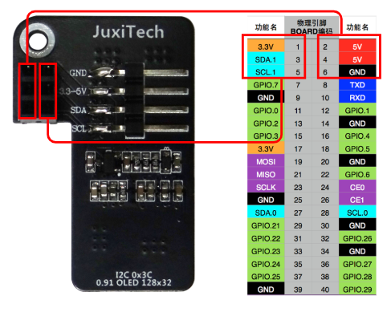
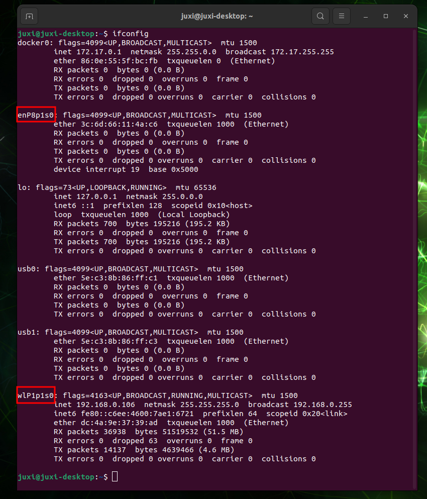
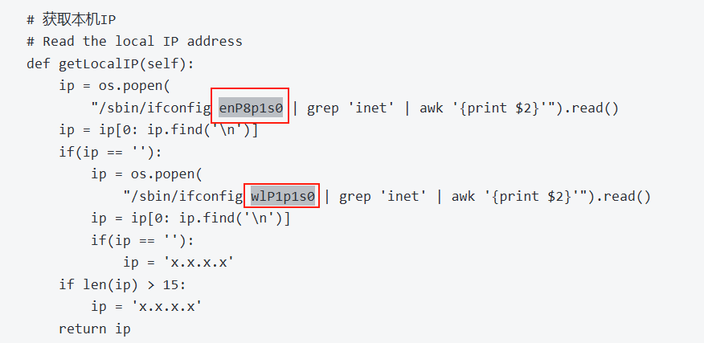
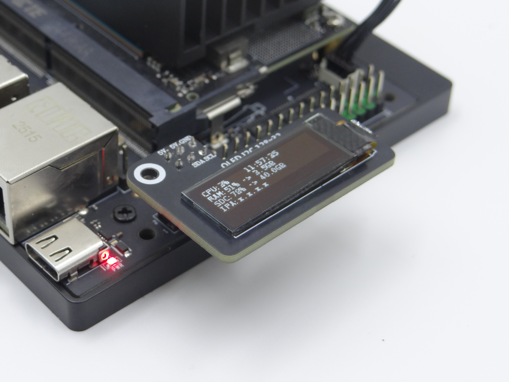
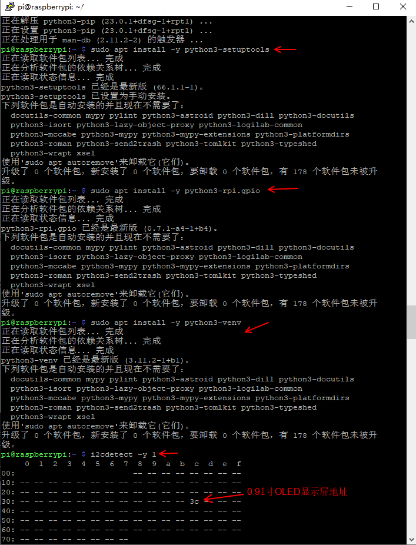
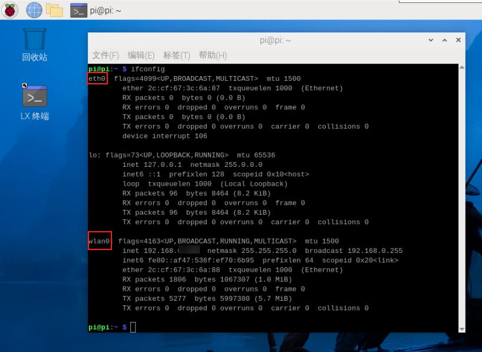
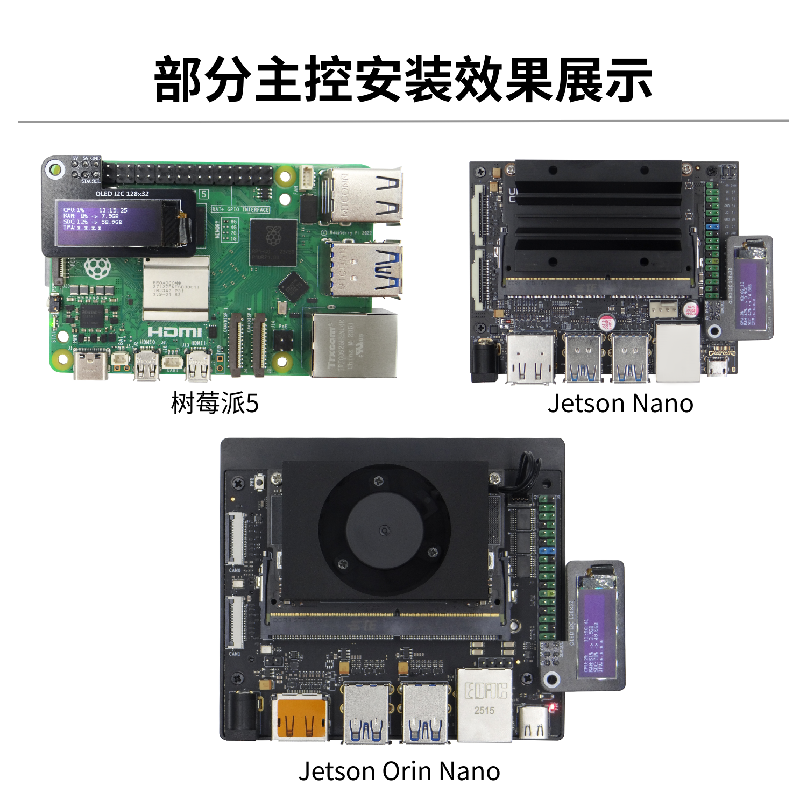

[English](../en/0.91-inch-oled-tutorial.md) | [Deutsch](../de/0.91-inch-oled-tutorial.md) | [Español](../es/0.91-inch-oled-tutorial.md) | [Français](../fr/0.91-inch-oled-tutorial.md) | [Italiano](../it/0.91-inch-oled-tutorial.md) | [日本語](../ja/0.91-inch-oled-tutorial.md) | 한국어 | [Português (BR)](../pt-br/0.91-inch-oled-tutorial.md) | [Português (PT)](../pt-pt/0.91-inch-oled-tutorial.md) | [简体中文](../zh-hans/0.91-inch-oled-tutorial.md) | [繁體中文](../zh-hant/0.91-inch-oled-tutorial.md)

# Raspberry Pi/Jetson\-OLED 서브 디스플레이 튜토리얼

## Jetson 시리즈 메인보드

### 1、GPIO 핀 배치도

0\.91인치 OLED를 사용하여 I2C 통신 기능을 테스트합니다. 아래 배선에 따라 연결하십시오：

**주의：잘못 연결하거나 핀을 단락시키지 마십시오. 실수하면 메인보드 하드웨어가 손상될 수 있습니다！**



### 2、I2C 테스트

#### 2\.1、종속성 설치

```PowerShell
sudo apt install -y python3-pip
sudo pip3 install smbus
sudo pip3 install Adafruit_SSD1306
```


#### 2\.2、I2C 장치

일반적인 개발 과정에서는 I2C 장치가 연결된 장치 버스와 장치 주소를 찾아야 합니다.

#### （1）I2C 버스 확인

터미널에서 아래 명령을 입력하면 장치의 모든 버스를 나열할 수 있습니다：

```PowerShell
i2cdetect -l
```

#### （2）I2C 장치 확인

터미널에서 아래 명령을 입력하면 지정한 버스의 I2C 장치를 나열할 수 있습니다：oled에 해당하는 I2C 주소는 0x3c 입니다

```PowerShell
i2cdetect -y -r *
```


### 3、ip 주소와 포트 확인

`ifconfig `를 사용하여 ip 주소와 포트를 확인합니다



실제 포트에 맞게 코드를 변경합니다



### 4、실험 결과

Oled\_i2c\.py 파일을 생성생성합니다

```PowerShell
sudo gedit Oled_i2c.py
```

아래 코드를 복사하여 붙여넣습니다

```python
#!/usr/bin/env python3
# coding=utf-8
import time
import os
import sys

i2c_num = 7
if len(sys.argv) > 1:
    if str(sys.argv[1]).isdigit():
        i2c_num = int(sys.argv[1])

print("i2c_num=", i2c_num)

cmd_i2c = "sudo i2cdetect -y -r " + str(i2c_num)
os.system(cmd_i2c)


import Adafruit_SSD1306 as SSD

from PIL import Image
from PIL import ImageDraw
from PIL import ImageFont

import subprocess


class Juxi_OLED:
    def __init__(self, i2c_bus=1, debug=False):
        self.__debug = debug
        self.__i2c_bus = i2c_bus
        self.__top = -2
        self.__x = 0

        self.__total_last = 0
        self.__idle_last = 0
        self.__str_CPU = "CPU:0%"


    def __del__(self):
        if self.__debug:
            print("---OLED-DEL---")

    # 初始化OLED，成功返回:True，失败返回:False
    # Initialize OLED, return True on success, False on failure
    def begin(self):
        try:
            self.__oled = SSD.SSD1306_128_32(
                rst=None, i2c_bus=self.__i2c_bus, gpio=1)
            self.__oled.begin()
            self.__oled.clear()
            self.__oled.display()
            self.__width = self.__oled.width
            self.__height = self.__oled.height
            self.__image = Image.new('1', (self.__width, self.__height))
            self.__draw = ImageDraw.Draw(self.__image)
            self.__font = ImageFont.truetype("DejaVuSansMono.ttf",8)    # ImageFont.load_default()
            if self.__debug:
                print("---OLED begin ok!---")
            return True
        except:
            # if self.__i2c_bus == 1:
            #     self.__i2c_bus = 8
            # elif self.__i2c_bus == 8:
            #     self.__i2c_bus = 1
            if self.__debug:
                print("---OLED no found!---")
            return False

    # 清除显示。refresh=True立即刷新，refresh=False不刷新。
    # Clear the display.  Refresh =True Refresh immediately, refresh=False refresh not
    def clear(self, refresh=False):
        self.__draw.rectangle(
            (0, 0, self.__width, self.__height), outline=0, fill=0)
        if refresh:
            self.refresh()

    # 增加字符。start_x start_y表示开始的点。text是要增加的字符。
    # refresh=True立即刷新，refresh=False不刷新。
    # Add characters.  Start_x Start_y indicates the starting point.  Text is the character to be added
    # Refresh =True Refresh immediately, refresh=False refresh not
    def add_text(self, start_x, start_y, text, refresh=False):
        if start_x > 128 or start_x < 0 or start_y < 0 or start_y > 32:
            if self.__debug:
                print("oled text: x, y input error!")
            return
        x = int(start_x + self.__x)
        y = int(start_y + self.__top)
        self.__draw.text((x, y), str(text), font=self.__font, fill=255)
        if refresh:
            self.refresh()

    # 写入一行字符text。refresh=True立即刷新，refresh=False不刷新。
    # line=[1, 4]
    # Write a line of character text.  Refresh =True Refresh immediately, refresh=False refresh not.
    def add_line(self, text, line=1, refresh=False):
        if line < 1 or line > 4:
            if self.__debug:
                print("oled line input error!")
            return
        y = int(8 * (line - 1))
        self.add_text(0, y, text, refresh)

    # 刷新OLED，显示内容
    # Refresh the OLED to display the content
    def refresh(self):
        self.__oled.image(self.__image)
        self.__oled.display()

    # 读取CPU占用率
    # Read the CPU usage rate
    def getCPULoadRate(self, index):
        count = 10
        if index == 0:
            f1 = os.popen("cat /proc/stat", 'r')
            stat1 = f1.readline()
            data_1 = []
            for i in range(count):
                data_1.append(int(stat1.split(' ')[i+2]))
            self.__total_last = data_1[0]+data_1[1]+data_1[2]+data_1[3] + \
                data_1[4]+data_1[5]+data_1[6]+data_1[7]+data_1[8]+data_1[9]
            self.__idle_last = data_1[3]
        elif index == 4:
            f2 = os.popen("cat /proc/stat", 'r')
            stat2 = f2.readline()
            data_2 = []
            for i in range(count):
                data_2.append(int(stat2.split(' ')[i+2]))
            total_now = data_2[0]+data_2[1]+data_2[2]+data_2[3] + \
                data_2[4]+data_2[5]+data_2[6]+data_2[7]+data_2[8]+data_2[9]
            idle_now = data_2[3]
            total = int(total_now - self.__total_last)
            idle = int(idle_now - self.__idle_last)
            usage = int(total - idle)
            usageRate = int(float(usage / total) * 100)
            self.__str_CPU = "CPU:" + str(usageRate) + "%"
            self.__total_last = 0
            self.__idle_last = 0
            # if self.__debug:
            #     print(self.__str_CPU)
        return self.__str_CPU

    # 读取系统时间
    # Read system time
    def getSystemTime(self):
        cmd = "date +%H:%M:%S"
        date_time = subprocess.check_output(cmd, shell=True)
        str_Time = str(date_time).lstrip('b\'')
        str_Time = str_Time.rstrip('\\n\'')
        # print(date_time)
        return str_Time

    # 读取内存占用率 和 总内存
    # Read the memory usage and total memory
    def getUsagedRAM(self):
        cmd = "free | awk 'NR==2{printf \"RAM:%2d%% -> %.1fGB \", 100*($2-$7)/$2, ($2/1048576.0)}'"
        FreeRam = subprocess.check_output(cmd, shell=True)
        str_FreeRam = str(FreeRam).lstrip('b\'')
        str_FreeRam = str_FreeRam.rstrip('\'')
        return str_FreeRam

    # 读取空闲的内存 / 总内存
    # Read free memory/total memory
    def getFreeRAM(self):
        cmd = "free -h | awk 'NR==2{printf \"RAM: %.1f/%.1fGB \", $7,$2}'"
        FreeRam = subprocess.check_output(cmd, shell=True)
        str_FreeRam = str(FreeRam).lstrip('b\'')
        str_FreeRam = str_FreeRam.rstrip('\'')
        return str_FreeRam

    # 读取TF卡空间占用率 / TF卡总空间
    # Read the TF card space usage/TOTAL TF card space
    def getUsagedDisk(self):
        cmd = "df -h | awk '$NF==\"/\"{printf \"SDC:%s -> %.1fGB\", $5, $2}'"
        Disk = subprocess.check_output(cmd, shell=True)
        str_Disk = str(Disk).lstrip('b\'')
        str_Disk = str_Disk.rstrip('\'')
        return str_Disk

    # 读取空闲的TF卡空间 / TF卡总空间
    # Read the free TF card space/total TF card space
    def getFreeDisk(self):
        cmd = "df -h | awk '$NF==\"/\"{printf \"Disk:%.1f/%.1fGB\", $4,$2}'"
        Disk = subprocess.check_output(cmd, shell=True)
        str_Disk = str(Disk).lstrip('b\'')
        str_Disk = str_Disk.rstrip('\'')
        return str_Disk

    # 获取本机IP
    # Read the local IP address
    def getLocalIP(self):
        ip = os.popen(
            "/sbin/ifconfig enP8p1s0 | grep 'inet' | awk '{print $2}'").read()
        ip = ip[0: ip.find('\n')]
        if(ip == ''):
            ip = os.popen(
                "/sbin/ifconfig wlP1p1s0 | grep 'inet' | awk '{print $2}'").read()
            ip = ip[0: ip.find('\n')]
            if(ip == ''):
                ip = 'x.x.x.x'
        if len(ip) > 15:
            ip = 'x.x.x.x'
        return ip

    # oled主要运行函数，在while循环里调用，可实现热插拔功能。
    # Oled mainly runs functions that are called in a while loop and can be hot-pluggable
    def main_program(self):
        state = False
        try:
            cpu_index = 0
            state = self.begin()
            while state:
                self.clear()
                str_CPU = self.getCPULoadRate(cpu_index)
                str_Time = self.getSystemTime()
                if cpu_index == 0:
                    str_FreeRAM = self.getUsagedRAM()
                    str_Disk = self.getUsagedDisk()
                    str_IP = "IPA:" + self.getLocalIP()
                self.add_text(0, 0, str_CPU)
                self.add_text(50, 0, str_Time)
                self.add_line(str_FreeRAM, 2)
                self.add_line(str_Disk, 3)
                self.add_line(str_IP, 4)
                # Display image.
                self.refresh()
                cpu_index = cpu_index + 1
                if cpu_index >= 5:
                    cpu_index = 0
                time.sleep(.1)
        except:
            if self.__debug:
                print("!!!---OLED refresh error---!!!")
            pass


if __name__ == "__main__":
    try:

        oled = Juxi_OLED(i2c_num, debug=True)
        while True:
            oled.main_program()
            time.sleep(2)
    except KeyboardInterrupt:
        oled.clear(True)
        del oled
        print(" Program closed! ")
        pass
```

프로그램을 시작하면 OLED에 시스템 CPU 사용률, 시스템 시간, 메모리 사용률 등의 시스템 정보가 표시됩니다：




## Raspberry Pi、Orange Pi


### 1\.I2C 옵션 열기

Raspberry Pi 시스템 설정에 들어가서 다음을 선택합니다：Preferences→Raspberry Pi Configuration→Interfaces→I2C 옵션을 찾아 켠 다음 시스템을 재부팅하면 됩니다.（아래 그림 참조）

명령 모드라면 `sudo raspi-config`를 입력해도 같은 옵션을 찾아 I2C를 켠 다음 시스템을 다시 시작하면 됩니다.


### 2\.I2C 라이브러리 설치

```PowerShell
sudo apt install -y python3-dev
sudo apt install -y python3-smbus i2c-tools
sudo apt install -y python3-pil
sudo apt install -y python3-pip
sudo apt install -y python3-setuptools
sudo apt install -y python3-rpi.gpio
sudo apt install -y python3-venv
```

여기서는 Python3를 사용합니다. I2C 라이브러리를 설치한 후 i2cdetect 명령으로 디스플레이 모듈이 인식되는지 확인합니다

```PowerShell
i2cdetect -y 1
```

장치가 주소“0x3c”로 감지됩니다（아래 그림）이 유형의 장치는 기본값이 16진수 주소입니다.



### 3\.폰트 파일 설정

코드에서는 `DejaVuSansMono.ttf` 폰트를 사용합니다：

```PowerShell
sudo apt-get install -y fonts-dejavu-core
```

또는 코드를 시스템에 이미 있는 폰트（예: `ImageFont.load_default()`）로 수정합니다

### 4\.권한 설정

I2C 장치 파일 권한이 올바른지 확인합니다：

```PowerShell
sudo chmod a+rw /dev/i2c-*  # 临时生效，永久生效需配置 udev 规则
```

### 5\.ip 주소와 포트 확인

` ifconfig `를 사용하여 실제 ip 주소와 포트를 확인합니다

```PowerShell
# （如未安装net-tools）sudo apt install net-tools
ifconfig
```




실제 포트에 맞게 코드에서 아래 두 곳의 상자로 표시된 내용을 변경합니다


### 6\.Oled\_i2c\.py 파일 생성

Home 디렉터리에 Oled\_i2c\.py 파일을 생성합니다

```PowerShell
# （如未安装gedit） sudo apt install gedit
sudo gedit Oled_i2c.py
```

아래 코드를 복사하여 파일에 붙여넣고 저장한 뒤 닫습니다

위 섹션 4에 표시된 코드와 동일합니다. 이 저장소에도 [`oled_i2c.py`](../../oled_i2c.py) 로 포함되어 있습니다 — Home 디렉터리에 저장하고 필요하면 버스 번호를 수정하세요.

### 7\.가상 환경 생성

```PowerShell
# 가상 환경 도구 설치 (미설치 시) sudo apt-get install -y python3-venv

# 가상 환경 생성
python3 -m venv oled_env

# 가상 환경 활성화source oled_env/bin/activate  # 활성화 후 명령줄 앞에 (oled_env) 가 표시됨# 가상 환경에서 의존성 설치
# 알리바바 클라우드 미러로 설치
pip install Adafruit_SSD1306 -i https://mirrors.aliyun.com/pypi/simple/

# pillow(의존 라이브러리)도 함께 설치
pip install pillow -i https://mirrors.aliyun.com/pypi/simple/

# 코드 실행 (가상 환경 내에서 필요)

# 해당 simple 폴더로 이동
cd /home/pi/oled-screen/luma.examples/examples
python3 oled_i2c.py  # 默认总线 7
# 또는 버스 지정 (예: 버스 1)
python3 oled_i2c.py 1
#권한 오류가 표시되면, sudo 설정 또는 I2C 장치 권한을 확인하세요
```




